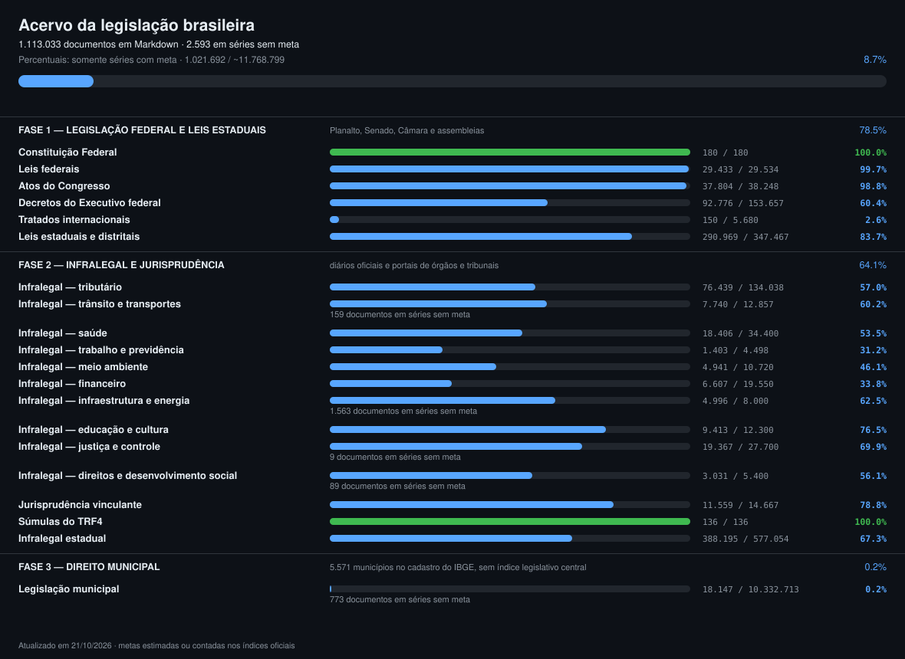

# Progresso

Gerado em 21/10/2026 07:18:07 (America/Recife). Escopo: `scripts/plano.py`.

Percentuais usam somente documentos e metas das séries com universo estimado ou contado. Séries sem meta ficam fora do cálculo. Cada série contribui até sua própria meta. Volume não comprova integralidade das fontes ou qualidade das conversões.

**1.113.033 documentos · 1.021.692 / ~11.768.799 nas séries com meta (8.7%) · 2.593 sem meta**

Há 7.544 pendências de integralidade registradas em [registro auditável](scripts/dados/pendencias-integralidade-publicadas.json). Esses documentos ficam fora da contagem até validação; seus textos e histórico são preservados.

## Fase 1 — legislação federal e leis estaduais

Planalto, Senado, Câmara e assembleias.

457.645 documentos · 451.312 / ~574.766 nas séries com meta (78.5%) · 0 sem meta

### Constituição Federal

180 / ~180 documentos (100.0%)

| | Tipo de norma | Tem | Meta | Pasta | Fonte |
| :-: | --- | ---: | ---: | --- | --- |
| ✅ | Constituição de 1988 (texto vigente) | 1 | 1 | `constituicao.md` | https://www.planalto.gov.br |
| ✅ | Constituições históricas (1824, 1891, 1934, 1937, 1946, 1967, 1969) | 7 | 7 | `federal/constituicoes-historicas` | https://www.planalto.gov.br |
| ✅ | Emendas constitucionais e de revisão | 172 | 172 | `federal/emendas-constitucionais` | https://normas.leg.br |

### Leis federais

29.433 / ~29.534 documentos (99.7%)

| | Tipo de norma | Tem | Meta | Pasta | Fonte |
| :-: | --- | ---: | ---: | --- | --- |
| 🟦 | Leis ordinárias, numeradas e não numeradas (1822–hoje) | 16.784 | 16.883 | `federal/leis-ordinarias` | Senado (índice) + normas.leg.br (texto) |
| ✅ | Leis complementares | 239 | 239 | `federal/leis-complementares` | normas.leg.br |
| ✅ | Leis delegadas (série encerrada) | 13 | 13 | `federal/leis-delegadas` | normas.leg.br |
| ✅ | Leis constitucionais da Carta de 1937 (1938–1946) | 21 | 21 | `federal/leis-constitucionais` | https://www.planalto.gov.br/ccivil_03/LEIS/LCT/Quadro_Lct.htm |
| 🟦 | Decretos-leis (série encerrada em 1988) | 12.376 | 12.378 | `federal/decretos-lei` | normas.leg.br |

### Atos do Congresso

37.806 documentos · 37.804 / ~38.248 nas séries com meta (98.8%) · 0 sem meta

| | Tipo de norma | Tem | Meta | Pasta | Fonte |
| :-: | --- | ---: | ---: | --- | --- |
| 🟦 | Decretos legislativos | 21.359 | 21.775 | `federal/decretos-legislativos` | normas.leg.br |
| ✅ | Medidas provisórias (originais e reedições) | 7.499 | 7.497 | `federal/medidas-provisorias` | Planalto + normas.leg.br |
| 🟦 | Resoluções do Senado Federal | 6.574 | 6.578 | `federal/resolucoes-senado` | normas.leg.br |
| 🟦 | Resoluções da Câmara dos Deputados | 2.280 | 2.300 | `federal/resolucoes-camara` | camara.leg.br |
| 🟦 | Resoluções do Congresso Nacional e da Revisão Constitucional | 91 | 95 | `federal/resolucoes-congresso` | normas.leg.br |
| ✅ | Regimentos internos (Senado, Câmara, Congresso) | 3 | 3 | `federal/regimentos` | senado.leg.br, camara.leg.br |

### Decretos do Executivo federal

92.776 / ~153.657 documentos (60.4%)

| | Tipo de norma | Tem | Meta | Pasta | Fonte |
| :-: | --- | ---: | ---: | --- | --- |
| 🟦 | Decretos numerados (1889–hoje, as duas séries) | 78.246 | 139.127 | `federal/decretos` | normas.leg.br + Planalto |
| ✅ | Decretos não numerados | 14.510 | 14.510 | `federal/decretos-nao-numerados` | Planalto |
| ✅ | Regulamentos consolidados (RIR, RIPI, Aduaneiro, RPS, PAF) | 20 | 20 | `federal/regulamentos` | Planalto |

### Tratados internacionais

161 documentos · 150 / ~5.680 nas séries com meta (2.6%) · 0 sem meta

| | Tipo de norma | Tem | Meta | Pasta | Fonte |
| :-: | --- | ---: | ---: | --- | --- |
| ⬜️ | Decretos de promulgação de tratados | 0 | 4.000 | `tratados/decretos` | Concórdia/MRE + Planalto |
| 🟦 | Tratados de direitos humanos (status constitucional/supralegal) | 12 | 40 | `tratados/direitos-humanos` | MRE + Planalto |
| 🟦 | Convenções da OIT ratificadas | 98 | 100 | `tratados/oit` | ilo.org + MTE |
| ✅ | Acordos de bitributação | 51 | 40 | `tratados/bitributacao` | RFB |
| ⬜️ | Normas do Mercosul internalizadas | 0 | 1.500 | `tratados/mercosul` | mercosur.int |

### Leis estaduais e distritais

297.289 documentos · 290.969 / ~347.467 nas séries com meta (83.7%) · 0 sem meta

| | Tipo de norma | Tem | Meta | Pasta | Fonte |
| :-: | --- | ---: | ---: | --- | --- |
| ✅ | Constituições estaduais e Lei Orgânica do DF | 27 | 27 | `estaduais/*/constituicao`, `estaduais/*/lei-organica` | Assembleias e Casas Civis |
| 🟦 | Constituições estaduais históricas | 9 | 40 | `estaduais/*/constituicoes-historicas` | Assembleias |
| 🟦 | Emendas constitucionais estaduais | 2.023 | 2.200 | `estaduais/*/emendas-constitucionais` | Assembleias |
| 🟦 | Leis ordinárias estaduais | 275.324 | 330.000 | `estaduais/*/leis-ordinarias` | 19 scripts, uma fonte por UF |
| 🟦 | Leis complementares estaduais | 12.386 | 14.000 | `estaduais/*/leis-complementares` | 19 scripts, uma fonte por UF |
| ✅ | Decretos-leis e leis delegadas estaduais | 6.666 | 600 | `estaduais/*/decretos-lei`, `estaduais/*/leis-delegadas`, `estaduais/*/decretos-lei-complementares` | Assembleias |
| ✅ | Leis promulgadas, constitucionais e emendas à Lei Orgânica | 854 | 600 | `estaduais/*/leis-promulgadas`, `estaduais/*/leis-constitucionais`, `estaduais/*/emendas-lei-organica` | Assembleias |

## Fase 2 — infralegal e jurisprudência

Diários oficiais e portais de órgãos e tribunais.

636.468 documentos · 552.233 / ~861.320 nas séries com meta (64.1%) · 1.820 sem meta

### Infralegal — tributário

76.439 / ~134.038 documentos (57.0%)

| | Tipo de norma | Tem | Meta | Pasta | Fonte |
| :-: | --- | ---: | ---: | --- | --- |
| 🟦 | Receita Federal: instruções normativas, portarias, atos declaratórios, soluções de consulta e pareceres normativos | 74.267 | 115.238 | `reguladores/rfb` | RFB — Sijut (23 espécies normativas) e Diário Oficial da União |
| 🟦 | CONFAZ: convênios, protocolos e ajustes SINIEF | 1.148 | 12.000 | `reguladores/confaz` | Diário Oficial da União (in.gov.br) |
| 🟦 | Tesouro Nacional: portarias e instruções | 197 | 2.000 | `reguladores/stn` | Diário Oficial da União (in.gov.br) |
| 🟦 | Procuradoria-Geral da Fazenda Nacional | 124 | 1.500 | `reguladores/pgfn` | Diário Oficial da União (in.gov.br) |
| 🟦 | CARF: súmulas e resoluções | 63 | 300 | `reguladores/carf` | Diário Oficial da União (in.gov.br) |
| 🟦 | Ministério da Fazenda: demais atos normativos | 640 | 3.000 | `reguladores/fazenda` | Diário Oficial da União (in.gov.br) |

### Infralegal — trânsito e transportes

18.500 documentos · 7.740 / ~12.857 nas séries com meta (60.2%) · 159 sem meta

| | Tipo de norma | Tem | Meta | Pasta | Fonte |
| :-: | --- | ---: | ---: | --- | --- |
| 🟦 | CONTRAN: resoluções, deliberações e o Manual Brasileiro de Sinalização | 146 | 1.357 | `reguladores/contran` | Diário Oficial da União (in.gov.br) |
| 🟦 | SENATRAN/DENATRAN: portarias | 1.274 | 1.500 | `reguladores/senatran` | Diário Oficial da União (in.gov.br) |
| 🟦 | ANTT: resoluções | 4.136 | 6.000 | `reguladores/antt` | Diário Oficial da União (in.gov.br) |
| ✅ | ANTAQ: resoluções | 2.719 | 500 | `reguladores/antaq` | Diário Oficial da União (in.gov.br) |
| ✅ | ANAC: resoluções e RBAC | 9.082 | 700 | `reguladores/anac` | Diário Oficial da União (in.gov.br) |
| 🟦 | Ministério dos Transportes: demais atos normativos | 684 | 2.000 | `reguladores/transportes` | Diário Oficial da União (in.gov.br) |
| 🟦 | Ministério de Portos e Aeroportos | 300 | 800 | `reguladores/portos-aeroportos` | Diário Oficial da União (in.gov.br) |
| — | Ministério da Infraestrutura (denominação histórica) | 159 | desconhecida | `reguladores/ministerio-da-infraestrutura` | Diário Oficial da União (órgão literal da publicação) |

### Infralegal — saúde

40.681 documentos · 18.406 / ~34.400 nas séries com meta (53.5%) · 0 sem meta

| | Tipo de norma | Tem | Meta | Pasta | Fonte |
| :-: | --- | ---: | ---: | --- | --- |
| ✅ | ANVISA: RDC, instruções normativas e portarias | 25.255 | 3.100 | `reguladores/anvisa` | Diário Oficial da União (in.gov.br) |
| 🟦 | Ministério da Saúde: portarias GM/MS e consolidadas | 14.559 | 30.000 | `reguladores/ms` | Diário Oficial da União (in.gov.br) |
| 🟦 | Conselho Nacional de Saúde: resoluções | 147 | 700 | `reguladores/cns` | Diário Oficial da União (in.gov.br) |
| ✅ | ANS: resoluções normativas | 720 | 600 | `reguladores/ans` | Diário Oficial da União (in.gov.br) |

### Infralegal — trabalho e previdência

2.374 documentos · 1.403 / ~4.498 nas séries com meta (31.2%) · 0 sem meta

| | Tipo de norma | Tem | Meta | Pasta | Fonte |
| :-: | --- | ---: | ---: | --- | --- |
| 🟦 | Ministério do Trabalho: normas regulamentadoras (NR-1 a NR-38) e portarias | 629 | 3.038 | `reguladores/mte` | Diário Oficial da União (in.gov.br) |
| ✅ | INSS: instruções normativas | 495 | 160 | `reguladores/inss` | Diário Oficial da União (in.gov.br) |
| 🟦 | Secretaria de Previdência: instruções normativas e portarias | 214 | 900 | `reguladores/sprev` | Diário Oficial da União (in.gov.br) |
| ✅ | PREVIC: resoluções e instruções | 1.036 | 400 | `reguladores/previc` | Diário Oficial da União (in.gov.br) |

### Infralegal — meio ambiente

14.436 documentos · 4.941 / ~10.720 nas séries com meta (46.1%) · 0 sem meta

| | Tipo de norma | Tem | Meta | Pasta | Fonte |
| :-: | --- | ---: | ---: | --- | --- |
| 🟦 | CONAMA: resoluções | 7 | 520 | `reguladores/conama` | Diário Oficial da União (in.gov.br) |
| 🟦 | IBAMA: instruções normativas e portarias | 279 | 1.500 | `reguladores/ibama` | Diário Oficial da União (in.gov.br) |
| ✅ | ICMBio: instruções normativas | 629 | 400 | `reguladores/icmbio` | Diário Oficial da União (in.gov.br) |
| 🟦 | ANA e CNRH: resoluções | 159 | 3.000 | `reguladores/ana` | Diário Oficial da União (in.gov.br) |
| 🟦 | Serviço Florestal Brasileiro: instruções normativas | 20 | 200 | `reguladores/sfb` | Diário Oficial da União (in.gov.br) |
| ✅ | Ministério da Agricultura: instruções normativas | 11.946 | 3.000 | `reguladores/mapa` | Diário Oficial da União (in.gov.br) |
| 🟦 | Ministério do Meio Ambiente: demais atos normativos | 476 | 1.500 | `reguladores/mma` | Diário Oficial da União (in.gov.br) |
| ✅ | Ministério da Pesca e Aquicultura | 920 | 600 | `reguladores/pesca` | Diário Oficial da União (in.gov.br) |

### Infralegal — financeiro

7.743 documentos · 6.607 / ~19.550 nas séries com meta (33.8%) · 0 sem meta

| | Tipo de norma | Tem | Meta | Pasta | Fonte |
| :-: | --- | ---: | ---: | --- | --- |
| 🟦 | Banco Central e CMN: resoluções e circulares | 1.333 | 10.200 | `reguladores/bcb` | Diário Oficial da União (in.gov.br) |
| 🟦 | CVM: instruções e resoluções | 319 | 500 | `reguladores/cvm` | Diário Oficial da União (in.gov.br) |
| ✅ | SUSEP e CNSP: circulares e resoluções | 2.336 | 1.200 | `reguladores/susep` | Diário Oficial da União (in.gov.br) |
| 🟦 | CADE: resoluções | 90 | 300 | `reguladores/cade` | Diário Oficial da União (in.gov.br) |
| 🟦 | COAF: resoluções | 58 | 150 | `reguladores/coaf` | Diário Oficial da União (in.gov.br) |
| 🟦 | Conselho Federal de Contabilidade: resoluções | 198 | 1.800 | `reguladores/cfc` | Diário Oficial da União (in.gov.br) |
| 🟦 | INMETRO: resoluções e instruções | 1.986 | 2.000 | `reguladores/inmetro` | Diário Oficial da União (in.gov.br) |
| 🟦 | Ministério do Desenvolvimento, Indústria, Comércio e Serviços | 1.285 | 3.000 | `reguladores/mdic` | Diário Oficial da União (in.gov.br) |
| 🟦 | Ministério do Empreendedorismo e da Microempresa | 138 | 400 | `reguladores/empreendedorismo` | Diário Oficial da União (in.gov.br) |

### Infralegal — infraestrutura e energia

20.633 documentos · 4.996 / ~8.000 nas séries com meta (62.5%) · 1.563 sem meta

| | Tipo de norma | Tem | Meta | Pasta | Fonte |
| :-: | --- | ---: | ---: | --- | --- |
| 🟦 | ANEEL: resoluções normativas e homologatórias | 1.010 | 2.000 | `reguladores/aneel` | Diário Oficial da União (in.gov.br) |
| 🟦 | ANP: resoluções | 230 | 1.000 | `reguladores/anp` | Diário Oficial da União (in.gov.br) |
| 🟦 | ANATEL: resoluções e atos | 117 | 800 | `reguladores/anatel` | Diário Oficial da União (in.gov.br) |
| 🟦 | ANM: resoluções (mineração) | 134 | 300 | `reguladores/anm` | Diário Oficial da União (in.gov.br) |
| 🟦 | Ministério de Minas e Energia, CNPE e CMSE | 1.171 | 1.500 | `reguladores/mme` | Diário Oficial da União (in.gov.br) |
| ✅ | Ministério das Comunicações | 8.117 | 800 | `reguladores/comunicacoes` | Diário Oficial da União (in.gov.br) |
| 🟦 | Ministério das Cidades | 734 | 800 | `reguladores/cidades` | Diário Oficial da União (in.gov.br) |
| ✅ | Ministério da Integração e do Desenvolvimento Regional | 7.557 | 800 | `reguladores/integracao` | Diário Oficial da União (in.gov.br) |
| — | Ministério do Desenvolvimento Regional (denominação histórica) | 1.563 | desconhecida | `reguladores/ministerio-do-desenvolvimento-regional` | Diário Oficial da União (órgão literal da publicação) |

### Infralegal — educação e cultura

17.282 documentos · 9.413 / ~12.300 nas séries com meta (76.5%) · 0 sem meta

| | Tipo de norma | Tem | Meta | Pasta | Fonte |
| :-: | --- | ---: | ---: | --- | --- |
| 🟦 | Conselho Nacional de Educação: resoluções e pareceres | 234 | 1.500 | `reguladores/cne` | Diário Oficial da União (in.gov.br) |
| ✅ | Ministério da Educação: portarias | 8.117 | 4.000 | `reguladores/mec` | Diário Oficial da União (in.gov.br) |
| 🟦 | INEP: portarias e instruções normativas | 602 | 1.200 | `reguladores/inep` | Diário Oficial da União (in.gov.br) |
| 🟦 | CAPES: instruções normativas e portarias | 312 | 1.000 | `reguladores/capes` | Diário Oficial da União (in.gov.br) |
| 🟦 | ANCINE: instruções normativas | 165 | 500 | `reguladores/ancine` | Diário Oficial da União (in.gov.br) |
| ✅ | IPHAN: portarias e instruções normativas | 527 | 400 | `reguladores/iphan` | Diário Oficial da União (in.gov.br) |
| ✅ | Ministério da Cultura | 3.722 | 1.200 | `reguladores/cultura` | Diário Oficial da União (in.gov.br) |
| ✅ | Ministério do Esporte | 410 | 400 | `reguladores/esporte` | Diário Oficial da União (in.gov.br) |
| ✅ | Ministério do Turismo | 779 | 600 | `reguladores/turismo` | Diário Oficial da União (in.gov.br) |
| ✅ | Ministério da Ciência, Tecnologia e Inovação | 2.414 | 1.500 | `reguladores/mcti` | Diário Oficial da União (in.gov.br) |

### Infralegal — justiça e controle

21.869 documentos · 19.367 / ~27.700 nas séries com meta (69.9%) · 9 sem meta

| | Tipo de norma | Tem | Meta | Pasta | Fonte |
| :-: | --- | ---: | ---: | --- | --- |
| ✅ | Ministério da Justiça e Segurança Pública | 3.062 | 3.000 | `reguladores/mj` | Diário Oficial da União (in.gov.br) |
| 🟦 | Controladoria-Geral da União: instruções normativas e portarias | 303 | 1.200 | `reguladores/cgu` | Diário Oficial da União (in.gov.br) |
| 🟦 | Advocacia-Geral da União: atos normativos | 388 | 1.500 | `reguladores/agu` | Diário Oficial da União (in.gov.br) |
| ✅ | Ministério Público da União: resoluções e portarias | 1.780 | 1.200 | `reguladores/mpu` | Diário Oficial da União (in.gov.br) |
| 🟦 | CNMP: resoluções e recomendações | 164 | 400 | `reguladores/cnmp` | Diário Oficial da União (in.gov.br) |
| 🟦 | Defensoria Pública da União | 173 | 400 | `reguladores/dpu` | Diário Oficial da União (in.gov.br) |
| 🟦 | Tribunal de Contas da União: instruções normativas e resoluções | 116 | 1.500 | `reguladores/tcu` | Diário Oficial da União (in.gov.br) |
| 🟦 | Conselhos federais de fiscalização profissional (CFM, COFEN, CONFEA/CREA e demais) | 5.735 | 7.000 | `reguladores/conselhos-profissionais` | Diário Oficial da União (in.gov.br) |
| — | Atos em rubricas gerais do DOU (órgão discriminado nos metadados) | 9 | desconhecida | `reguladores/editais-e-avisos`, `reguladores/entidades-de-fiscalizacao-dos-profission` | Diário Oficial da União; rubrica e órgão preservados sem atribuir meta de outra série |
| 🟦 | Presidência da República: atos normativos | 991 | 2.000 | `reguladores/presidencia` | Diário Oficial da União (in.gov.br) |
| 🟦 | Ministério da Gestão e da Inovação em Serviços Públicos | 1.842 | 2.500 | `reguladores/gestao` | Diário Oficial da União (in.gov.br) |
| 🟦 | Ministério do Planejamento e Orçamento | 1.033 | 1.200 | `reguladores/planejamento` | Diário Oficial da União (in.gov.br) |
| ✅ | Ministério da Defesa e comandos militares | 4.351 | 2.500 | `reguladores/defesa` | Diário Oficial da União (in.gov.br) |
| 🟦 | Ministério das Relações Exteriores | 340 | 800 | `reguladores/mre` | Diário Oficial da União (in.gov.br) |
| 🟦 | Atos administrativos normativos do Poder Judiciário publicados no DOU | 1.334 | 1.500 | `reguladores/poder-judiciario` | Diário Oficial da União (in.gov.br) |
| 🟦 | Atos administrativos normativos do Poder Legislativo publicados no DOU | 243 | 600 | `reguladores/poder-legislativo` | Diário Oficial da União (in.gov.br) |
| 🟦 | BNDES e demais estatais com poder normativo | 5 | 400 | `reguladores/bndes` | Diário Oficial da União (in.gov.br) |

### Infralegal — direitos e desenvolvimento social

4.437 documentos · 3.031 / ~5.400 nas séries com meta (56.1%) · 89 sem meta

| | Tipo de norma | Tem | Meta | Pasta | Fonte |
| :-: | --- | ---: | ---: | --- | --- |
| 🟦 | Ministério do Desenvolvimento e Assistência Social | 666 | 2.500 | `reguladores/mds` | Diário Oficial da União (in.gov.br) |
| ✅ | Ministério dos Direitos Humanos e da Cidadania | 906 | 800 | `reguladores/mdh` | Diário Oficial da União (in.gov.br) |
| 🟦 | Ministério das Mulheres | 65 | 300 | `reguladores/mulheres` | Diário Oficial da União (in.gov.br) |
| — | Ministério da Mulher, da Família e dos Direitos Humanos (denominação histórica) | 89 | desconhecida | `reguladores/ministerio-da-mulher-da-familia-e-dos-di` | Diário Oficial da União (órgão literal da publicação) |
| 🟦 | Ministério da Igualdade Racial | 61 | 300 | `reguladores/igualdade-racial` | Diário Oficial da União (in.gov.br) |
| 🟦 | Ministério dos Povos Indígenas | 239 | 300 | `reguladores/mpi` | Diário Oficial da União (in.gov.br) |
| ✅ | Ministério do Desenvolvimento Agrário e Agricultura Familiar | 2.411 | 1.200 | `reguladores/mda` | Diário Oficial da União (in.gov.br) |

### Jurisprudência vinculante

11.564 documentos · 11.559 / ~14.667 nas séries com meta (78.8%) · 0 sem meta

| | Tipo de norma | Tem | Meta | Pasta | Fonte |
| :-: | --- | ---: | ---: | --- | --- |
| ✅ | Súmulas vinculantes do STF | 62 | 62 | `jurisprudencia/stf/sumulas-vinculantes` | CNJ — Pangea/BNP (precedentes do STF) |
| ✅ | Súmulas do STF | 736 | 736 | `jurisprudencia/stf/sumulas` | stf.jus.br |
| ✅ | Temas de repercussão geral | 1.494 | 1.489 | `jurisprudencia/stf/repercussao-geral` | CNJ — Pangea/BNP (precedentes do STF) |
| 🟦 | Controle concentrado com eficácia erga omnes (ADI, ADC, ADPF, ADO) | 5.198 | 8.000 | `jurisprudencia/stf/controle-concentrado` | stf.jus.br |
| ✅ | Súmulas do STJ | 649 | 649 | `jurisprudencia/stj/sumulas` | stj.jus.br |
| ✅ | Temas de recursos repetitivos (STJ) | 1.474 | 1.474 | `jurisprudencia/stj/repetitivos` | STJ — dados abertos, Temas.csv (números únicos) |
| ✅ | Súmulas e orientações jurisprudenciais do TST | 1.157 | 1.157 | `jurisprudencia/tst` | tst.jus.br |
| 🟦 | Súmulas do TCU, TNU, STM e TSE | 398 | 700 | `jurisprudencia/outros-tribunais`, `jurisprudencia/tnu/sumulas` | tcu.gov.br, cjf.jus.br, stm.jus.br, tse.jus.br |
| 🟦 | Regimentos internos dos tribunais superiores | 2 | 6 | `jurisprudencia/regimentos` | portais dos tribunais |
| ✅ | Temas de uniformização da TNU, incluindo cancelados | 394 | 394 | `jurisprudencia/tnu/uniformizacao` | CNJ — Pangea/BNP (precedentes da TNU) |

### Súmulas do TRF4

136 / ~136 documentos (100.0%)

| | Tipo de norma | Tem | Meta | Pasta | Fonte |
| :-: | --- | ---: | ---: | --- | --- |
| ✅ | Súmulas, incluindo canceladas | 136 | 136 | `jurisprudencia/trf4/sumulas` | https://www.trf4.jus.br/trf4/controlador.php?acao=sumulas_trf4 |

### Infralegal estadual

400.374 documentos · 388.195 / ~577.054 nas séries com meta (67.3%) · 0 sem meta

| | Tipo de norma | Tem | Meta | Pasta | Fonte |
| :-: | --- | ---: | ---: | --- | --- |
| 🟦 | Decretos dos governadores (27 UF) | 307.818 | 400.000 | `estaduais/*/decretos`, `estaduais/*/decretos-nao-numerados` | Casas Civis e diários oficiais estaduais |
| ⬜️ | Regulamentos do ICMS (RICMS das 27 UF) | 0 | 27 | `estaduais/*/regulamentos` | Secretarias de Fazenda |
| 🟦 | Instruções normativas e portarias das SEFAZ | 1.432 | 50.000 | `estaduais/*/instrucoes-normativas` | Secretarias de Fazenda |
| ⬜️ | Resoluções e decisões normativas dos TCE | 0 | 10.000 | `estaduais/*/resolucoes-tce` | Tribunais de Contas estaduais |
| ⬜️ | Resoluções e provimentos dos TJ e das Corregedorias | 0 | 8.000 | `estaduais/*/resolucoes-tj` | Tribunais de Justiça |
| 🟦 | Regimentos internos das Assembleias | 18 | 27 | `estaduais/*/regimentos` | Assembleias |
| 🟦 | Decretos legislativos estaduais | 17.353 | 20.000 | `estaduais/*/decretos-legislativos` | Assembleias (SAPL e sistemas próprios) |
| ✅ | Resoluções das Assembleias | 37.179 | 25.000 | `estaduais/*/resolucoes` | Assembleias (SAPL e sistemas próprios) |
| 🟦 | Portarias das administrações estaduais e distrital | 33.821 | 60.000 | `estaduais/*/portarias` | SINJ-DF, Legisla Goiás e sistemas equivalentes |
| 🟦 | Deliberações, súmulas administrativas, provimentos e pareceres normativos | 2.753 | 4.000 | `estaduais/*/deliberacoes`, `estaduais/*/sumulas`, `estaduais/*/provimentos`, `estaduais/*/pareceres-normativos` | SINJ-DF, Legisla Goiás e sistemas equivalentes |

## Fase 3 — direito municipal

5.571 municípios no cadastro do IBGE, sem índice legislativo central.

18.920 documentos · 18.147 / ~10.332.713 nas séries com meta (0.2%) · 773 sem meta

### Legislação municipal

18.920 documentos · 18.147 / ~10.332.713 nas séries com meta (0.2%) · 773 sem meta

| | Tipo de norma | Tem | Meta | Pasta | Fonte |
| :-: | --- | ---: | ---: | --- | --- |
| 🟦 | Leis orgânicas municipais e suas emendas | 2.054 | 5.571 | `municipais/*/*/lei-organica`, `municipais/*/*/emendas-lei-organica` | diários das associações estaduais de municípios |
| ⬜️ | Planos diretores | 0 | 5.571 | `municipais/*/*/plano-diretor` | portais municipais |
| 🟦 | Códigos tributários municipais | 1 | 5.571 | `municipais/*/*/codigo-tributario` | portais municipais |
| 🟦 | Códigos de obras, posturas e zoneamento | 1 | 16.000 | `municipais/*/*/codigos` | portais municipais |
| 🟦 | Leis ordinárias e complementares municipais (27 capitais primeiro) | 8.702 | 8.300.000 | `municipais/*/*/leis-ordinarias`, `municipais/*/*/leis-complementares` | Câmaras municipais |
| — | Decretos legislativos municipais | 302 | desconhecida | `municipais/*/*/decretos-legislativos` | SAPL/Interlegis; universo nacional ainda desconhecido |
| — | Resoluções municipais | 471 | desconhecida | `municipais/*/*/resolucoes` | SAPL/Interlegis; universo nacional ainda desconhecido |
| 🟦 | Decretos municipais | 7.389 | 2.000.000 | `municipais/*/*/decretos` | prefeituras e diários oficiais |

---

## Pastas fora do plano

| Pasta | Arquivos |
| --- | ---: |
| `reguladores/ministerio-da-economia/portarias` | 636 |
| `reguladores/ministerio-da-economia/resolucoes` | 165 |
| `reguladores/ministerio-da-cidadania/portarias` | 133 |
| `reguladores/ministerio-da-cidadania/deliberacoes` | 50 |
| `reguladores/ministerio-da-economia/circulares` | 30 |
| `reguladores/ministerio-da-cidadania/resolucoes` | 28 |
| `reguladores/ministerio-da-economia/instrucoes-normativas` | 15 |
| `reguladores/ministerio-da-cidadania/instrucoes-normativas` | 11 |
