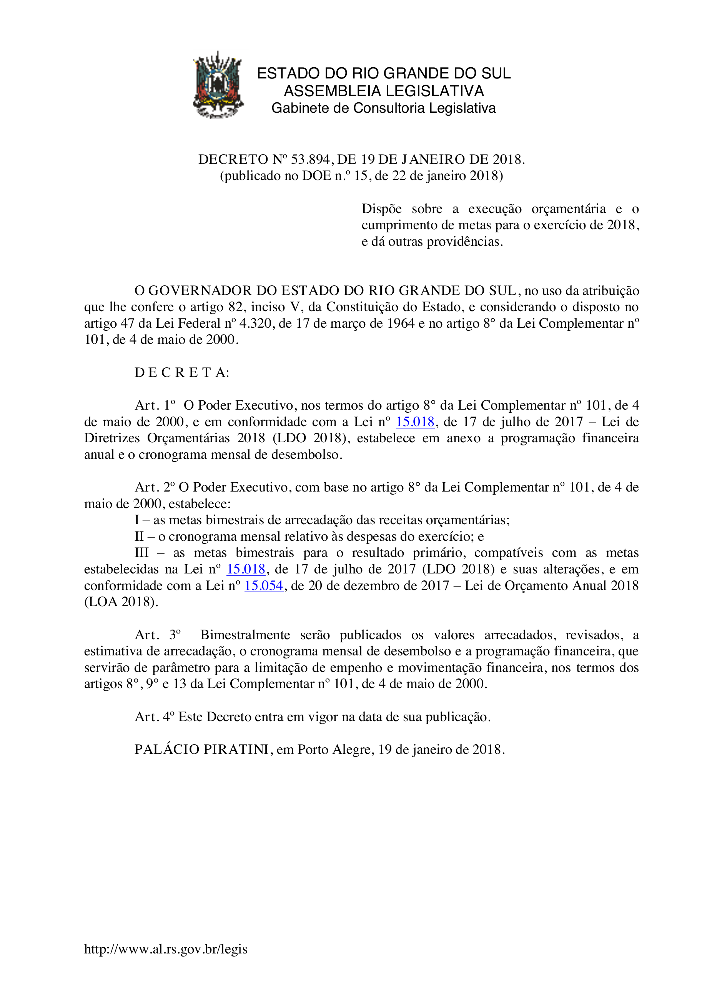
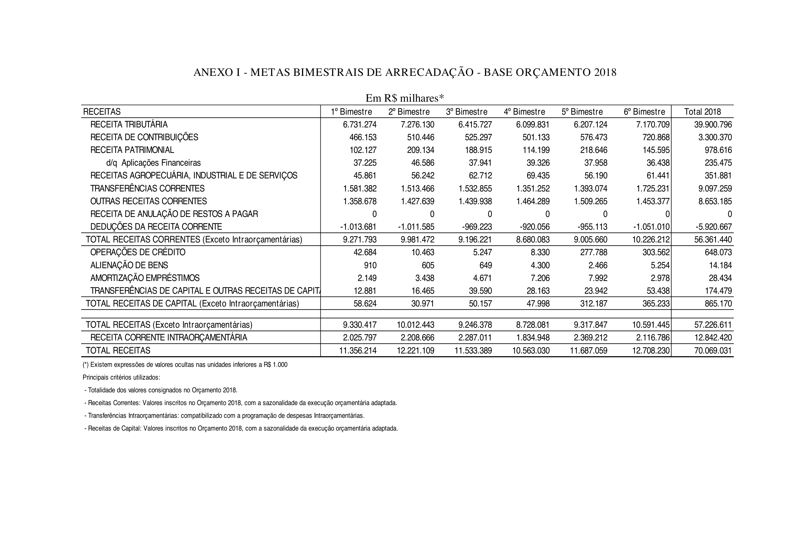
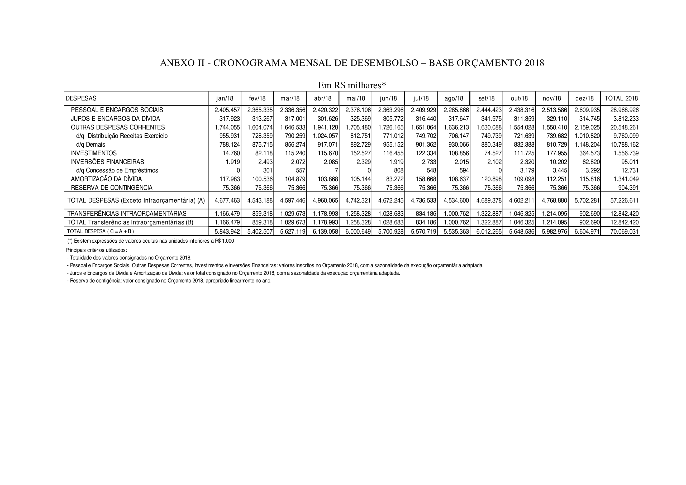
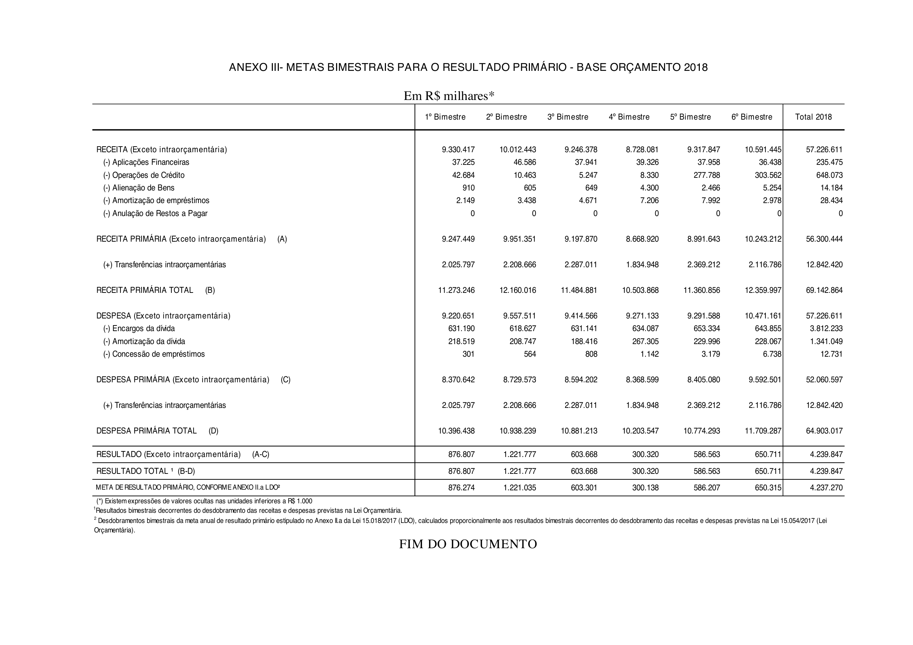

# Decreto nº 53.894, de 19/01/2018

ESTADO DO RIO GRANDE DO SUL ASSEMBLEIA LEGISLATIVA Gabinete de Consultoria Legislativa

DECRETO Nº 53.894, DE 19 DE JANEIRO DE 2018. (publicado no DOE n.º 15, de 22 de janeiro 2018)

Dispõe sobre a execução orçamentária e o cumprimento de metas para o exercício de 2018, e dá outras providências.

O GOVERNADOR DO ESTADO DO RIO GRANDE DO SUL, no uso da atribuição que lhe confere o artigo 82, inciso V, da Constituição do Estado, e considerando o disposto no artigo 47 da Lei Federal nº 4.320, de 17 de março de 1964 e no artigo 8° da Lei Complementar nº 101, de 4 de maio de 2000.

D E C R E T A:

**Art. 1º** O Poder Executivo, nos termos do artigo 8° da Lei Complementar nº 101, de 4 de maio de 2000, e em conformidade com a Lei nº 15.018, de 17 de julho de 2017 – Lei de Diretrizes Orçamentárias 2018 (LDO 2018), estabelece em anexo a programação financeira anual e o cronograma mensal de desembolso.

**Art. 2º** O Poder Executivo, com base no artigo 8° da Lei Complementar nº 101, de 4 de maio de 2000, estabelece:

I – as metas bimestrais de arrecadação das receitas orçamentárias;

II – o cronograma mensal relativo às despesas do exercício; e

III – as metas bimestrais para o resultado primário, compatíveis com as metas estabelecidas na Lei nº 15.018, de 17 de julho de 2017 (LDO 2018) e suas alterações, e em conformidade com a Lei nº 15.054, de 20 de dezembro de 2017 – Lei de Orçamento Anual 2018 (LOA 2018).

**Art. 3º** Bimestralmente serão publicados os valores arrecadados, revisados, a estimativa de arrecadação, o cronograma mensal de desembolso e a programação financeira, que servirão de parâmetro para a limitação de empenho e movimentação financeira, nos termos dos artigos 8°, 9° e 13 da Lei Complementar nº 101, de 4 de maio de 2000.

**Art. 4º** Este Decreto entra em vigor na data de sua publicação.

PALÁCIO PIRATINI, em Porto Alegre, 19 de janeiro de 2018.

http://www.al.rs.gov.br/legis

ANEXO I - METAS BIMESTRAIS DE ARRECADAÇÃO - BASE ORÇAMENTO 2018

Em R$ milhares*

RECEITAS 1º Bimestre 2º Bimestre 3º Bimestre 4º Bimestre 5º Bimestre 6º Bimestre Total 2018 RECEITA TRIBUTÁRIA 6.731.274 7.276.130 6.415.727 6.099.831 6.207.124 7.170.709 39.900.796 RECEITA DE CONTRIBUIÇÕES 466.153 510.446 525.297 501.133 576.473 720.868 3.300.370 RECEITA PATRIMONIAL 102.127 209.134 188.915 114.199 218.646 145.595 978.616 d/q Aplicações Financeiras 37.225 46.586 37.941 39.326 37.958 36.438 235.475 RECEITAS AGROPECUÁRIA, INDUSTRIAL E DE SERVIÇOS 45.861 56.242 62.712 69.435 56.190 61.441 351.881 TRANSFERÊNCIAS CORRENTES 1.581.382 1.513.466 1.532.855 1.351.252 1.393.074 1.725.231 9.097.259 OUTRAS RECEITAS CORRENTES 1.358.678 1.427.639 1.439.938 1.464.289 1.509.265 1.453.377 8.653.185 RECEITA DE ANULAÇÃO DE RESTOS A PAGAR 0 0 0 0 0 0 0 DEDUÇÕES DA RECEITA CORRENTE -1.013.681 -1.011.585 -969.223 -920.056 -955.113 -1.051.010 -5.920.667 TOTAL RECEITAS CORRENTES (Exceto Intraorçamentárias) 9.271.793 9.981.472 9.196.221 8.680.083 9.005.660 10.226.212 56.361.440 OPERAÇÕES DE CRÉDITO 42.684 10.463 5.247 8.330 277.788 303.562 648.073 ALIENAÇÃO DE BENS 910 605 649 4.300 2.466 5.254 14.184 AMORTIZAÇÃO EMPRÉSTIMOS 2.149 3.438 4.671 7.206 7.992 2.978 28.434 TRANSFERÊNCIAS DE CAPITAL E OUTRAS RECEITAS DE CAPITAL 12.881 16.465 39.590 28.163 23.942 53.438 174.479 TOTAL RECEITAS DE CAPITAL (Exceto Intraorçamentárias) 58.624 30.971 50.157 47.998 312.187 365.233 865.170

TOTAL RECEITAS (Exceto Intraorçamentárias) 9.330.417 10.012.443 9.246.378 8.728.081 9.317.847 10.591.445 57.226.611 RECEITA CORRENTE INTRAORÇAMENTÁRIA 2.025.797 2.208.666 2.287.011 1.834.948 2.369.212 2.116.786 12.842.420 TOTAL RECEITAS 11.356.214 12.221.109 11.533.389 10.563.030 11.687.059 12.708.230 70.069.031

(*) Existem expressões de valores ocultas nas unidades inferiores a R$ 1.000

Principais critérios utilizados: - Totalidade dos valores consignados no Orçamento 2018. - Receitas Correntes: Valores inscritos no Orçamento 2018, com a sazonalidade da execução orçamentária adaptada. - Transferências Intraorçamentárias: compatibilizado com a programação de despesas Intraorçamentárias. - Receitas de Capital: Valores inscritos no Orçamento 2018, com a sazonalidade da execução orçamentária adaptada.

ANEXO II - CRONOGRAMA MENSAL DE DESEMBOLSO – BASE ORÇAMENTO 2018

Em R$ milhares*

DESPESAS jan/18 fev/18 mar/18 abr/18 mai/18 jun/18 jul/18 ago/18 set/18 out/18 nov/18 dez/18 TOTAL 2018 PESSOAL E ENCARGOS SOCIAIS 2.405.457 2.365.335 2.336.356 2.420.322 2.376.106 2.363.296 2.409.929 2.285.866 2.444.423 2.438.316 2.513.586 2.609.935 28.968.926 JUROS E ENCARGOS DA DÍVIDA 317.923 313.267 317.001 301.626 325.369 305.772 316.440 317.647 341.975 311.359 329.110 314.745 3.812.233 OUTRAS DESPESAS CORRENTES 1.744.055 1.604.074 1.646.533 1.941.128 1.705.480 1.726.165 1.651.064 1.636.213 1.630.088 1.554.028 1.550.410 2.159.025 20.548.261 d/q Distribuição Receitas Exercício 955.931 728.359 790.259 1.024.057 812.751 771.012 749.702 706.147 749.739 721.639 739.682 1.010.820 9.760.099 d/q Demais 788.124 875.715 856.274 917.071 892.729 955.152 901.362 930.066 880.349 832.388 810.729 1.148.204 10.788.162 INVESTIMENTOS 14.760 82.118 115.240 115.670 152.527 116.455 122.334 108.856 74.527 111.725 177.955 364.573 1.556.739 INVERSÕES FINANCEIRAS 1.919 2.493 2.072 2.085 2.329 1.919 2.733 2.015 2.102 2.320 10.202 62.820 95.011 d/q Concessão de Empréstimos 0 301 557 7 0 808 548 594 0 3.179 3.445 3.292 12.731 AMORTIZACÃO DA DÍVIDA 117.983 100.536 104.879 103.868 105.144 83.272 158.668 108.637 120.898 109.098 112.251 115.816 1.341.049 RESERVA DE CONTINGÊNCIA 75.366 75.366 75.366 75.366 75.366 75.366 75.366 75.366 75.366 75.366 75.366 75.366 904.391 TOTAL DESPESAS (Exceto Intraorçamentária) (A) 4.677.463 4.543.188 4.597.446 4.960.065 4.742.321 4.672.245 4.736.533 4.534.600 4.689.378 4.602.211 4.768.880 5.702.281 57.226.611 TRANSFERÊNCIAS INTRAORÇAMENTÁRIAS 1.166.479 859.318 1.029.673 1.178.993 1.258.328 1.028.683 834.186 1.000.762 1.322.887 1.046.325 1.214.095 902.690 12.842.420 TOTAL Transferências Intraorçamentárias (B) 1.166.479 859.318 1.029.673 1.178.993 1.258.328 1.028.683 834.186 1.000.762 1.322.887 1.046.325 1.214.095 902.690 12.842.420 TOTAL DESPESA ( C = A + B ) 5.843.942 5.402.507 5.627.119 6.139.058 6.000.649 5.700.928 5.570.719 5.535.363 6.012.265 5.648.536 5.982.976 6.604.971 70.069.031

(*) Existem expressões de valores ocultas nas unidades inferiores a R$ 1.000

Principais critérios utilizados: - Totalidade dos valores consignados no Orçamento 2018. - Pessoal e Encargos Sociais, Outras Despesas Correntes, Investimentos e Inversões Financeiras: valores inscritos no Orçamento 2018, com a sazonalidade da execução orçamentária adaptada. - Juros e Encargos da Dívida e Amortização da Dívida: valor total consignado no Orçamento 2018, com a sazonalidade da execução orçamentária adaptada. - Reserva de contigência: valor consignado no Orçamento 2018, apropriado linearmente no ano.

ANEXO III- METAS BIMESTRAIS PARA O RESULTADO PRIMÁRIO - BASE ORÇAMENTO 2018

Em R$ milhares*

1º Bimestre 2º Bimestre 3º Bimestre 4º Bimestre 5º Bimestre 6º Bimestre Total 2018

RECEITA (Exceto intraorçamentária) 9.330.417 10.012.443 9.246.378 8.728.081 9.317.847 10.591.445 57.226.611 (-) Aplicações Financeiras 37.225 46.586 37.941 39.326 37.958 36.438 235.475 (-) Operações de Crédito 42.684 10.463 5.247 8.330 277.788 303.562 648.073 (-) Alienação de Bens 910 605 649 4.300 2.466 5.254 14.184 (-) Amortização de empréstimos 2.149 3.438 4.671 7.206 7.992 2.978 28.434 (-) Anulação de Restos a Pagar 0 0 0 0 0 0 0

RECEITA PRIMÁRIA (Exceto intraorçamentária) (A) 9.247.449 9.951.351 9.197.870 8.668.920 8.991.643 10.243.212 56.300.444

(+) Transferências intraorçamentárias 2.025.797 2.208.666 2.287.011 1.834.948 2.369.212 2.116.786 12.842.420

RECEITA PRIMÁRIA TOTAL (B) 11.273.246 12.160.016 11.484.881 10.503.868 11.360.856 12.359.997 69.142.864

DESPESA (Exceto intraorçamentária) 9.220.651 9.557.511 9.414.566 9.271.133 9.291.588 10.471.161 57.226.611 (-) Encargos da dívida 631.190 618.627 631.141 634.087 653.334 643.855 3.812.233 (-) Amortização da dívida 218.519 208.747 188.416 267.305 229.996 228.067 1.341.049 (-) Concessão de empréstimos 301 564 808 1.142 3.179 6.738 12.731

DESPESA PRIMÁRIA (Exceto intraorçamentária) (C) 8.370.642 8.729.573 8.594.202 8.368.599 8.405.080 9.592.501 52.060.597

(+) Transferências intraorçamentárias 2.025.797 2.208.666 2.287.011 1.834.948 2.369.212 2.116.786 12.842.420

DESPESA PRIMÁRIA TOTAL (D) 10.396.438 10.938.239 10.881.213 10.203.547 10.774.293 11.709.287 64.903.017

RESULTADO (Exceto intraorçamentária) (A-C) 876.807 1.221.777 603.668 300.320 586.563 650.711 4.239.847 RESULTADO TOTAL ¹ (B-D) 876.807 1.221.777 603.668 300.320 586.563 650.711 4.239.847 META DE RESULTADO PRIMÁRIO, CONFORME ANEXO II.a LDO² 876.274 1.221.035 603.301 300.138 586.207 650.315 4.237.270

(*) Existem expressões de valores ocultas nas unidades inferiores a R$ 1.000

¹ Resultados bimestrais decorrentes do desdobramento das receitas e despesas previstas na Lei Orçamentária.

² Desdobramentos bimestrais da meta anual de resultado primário estipulado no Anexo II.a da Lei 15.018/2017 (LDO), calculados proporcionalmente aos resultados bimestrais decorrentes do desdobramento das receitas e despesas previstas na Lei 15.054/2017 (Lei Orçamentária).

FIM DO DOCUMENTO

## Fonte oficial em reprodução integral

[PDF da fonte oficial preservado](../../_referencias/reparos-visuais-20261016/dec-53894-2018-id64432/fonte.pdf)

