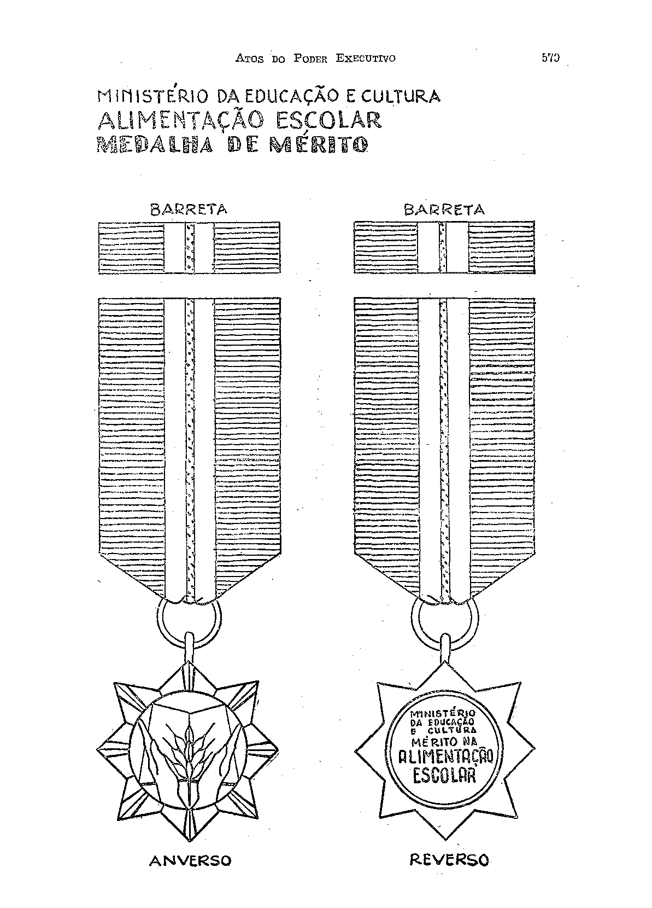

# Decreto nº 45.568 de 13/03/1959

DECRETO Nº 45.568 — DE 13 DE MARÇO DE 1959

Institui a Medalha do Mérito na Alimentação Escolar.

O Presidente da República, usando das atribuições que lhe confere o artigo 87, item I, da Constituição, decreta:

**Art. 1º** Fica instituída a Medalha do Mérito na Alimentação Escolar, a ser conferida aos que, por seus esforços, realizações e dedicação em favor da assistência e da educação alimentar dos escolares, se tornem merecedores de distinção.

**Art. 2º** A Medalha ora instituída será pendente de uma fita azul cobalto, de trinta e cinco milímetros de largura, carregada ao centro de uma listra amarelo-ouro de dois milímetros sôbre fundo branco, de oito milímetros, de acôrdo com o modêlo anexo, e obedecerá à seguinte especificação:

I — anverso: sôbre um resplendor de oito pontas, esmaltadas em branco, duas a duas, um ramo de trigo espigado sôbre um livro aberto e delimitado por duas mãos no sentido oblíquo da base; e

II — reverso: dentro de um círculo, os seguintes dizeres, colocados horizontalmente: “Ministério da Educação e Cultura — Mérito na Alimentação Escolar”.

**Parágrafo único.** A barreta terá as mesmas côres da fita descrita neste artigo, com trinta e cinco milímetros de largura por dez milímetros de altura.

**Art. 3º** A Medalha de que trata o presente decreto só terá valor quando acompanhada do respectivo diploma, expedido pelo Ministro de Estado da Educação e Cultura.

**Art. 4º** Caberá à Campanha Nacional de Merenda Escolar organizar, anualmente, a relação dos que deverão ser agraciados com a Medalha do Mérito na Alimentação Escolar, podendo, para isso, receber, dos seus órgãos de colaboração indicações de candidatos, devidamente justificadas.

**Art. 5º** O Ministro de Estado da Educação e Cultura baixará, no prazo de trinta dias, as instruções necessárias ao cumprimento do presente decreto.

**Art. 6º** Revogam-se as disposições em contrário.

Rio de Janeiro, 13 de março de 1959; 138.º da Independência e 71.º da República.

JUSCELINO KUBITSCHEK.

Clovis Salgado.

## Modelo anexo

