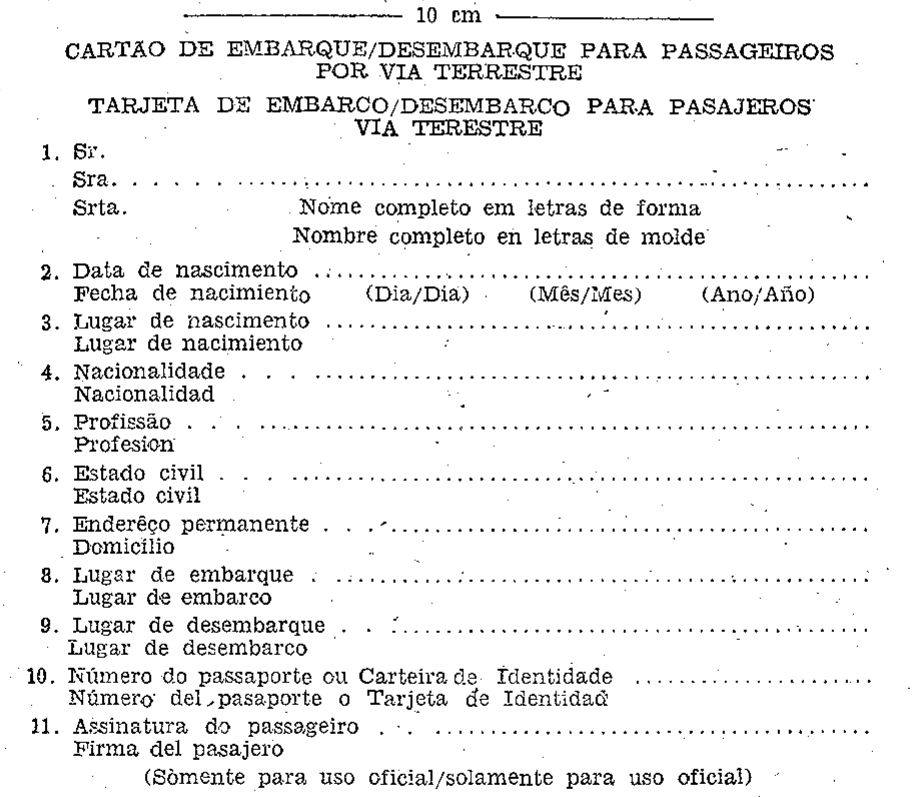

# Decreto nº 59.595 de 28/11/1966

DECRETO Nº 59.595 — DE 28 DE NOVEMBRO DE 1966

Dispõe sôbre a entrada e saída no Brasil dos passageiros de ônibus das linhas internacionais e turistas que viajam em automóveis particulares.

O Presidente da República, usando da atribuição que lhe confere o Artigo 87, item I da Constituição Federal:

Considerando que é necessário maior aproximação e estreitamento de relações entre os países vizinhos;

Considerando que a promoção do turismo é de interesse da economia nacional;

Considerando que deverão ser dadas facilidades para a entrada de turistas no território nacional, decreta:

**Art. 1º** Ficam dispensados de despacho consular os ônibus das emprêsas brasileiras e estrangeiras devidamente autorizadas pelo Govêrno brasileiro a fazer tráfego internacional.

**Art. 2º** O contrôle de embarque e desembarque dos passageiros, turistas, de ônibus internacionais será feito através do “Cartão de embarque/desembarque” (modêlo anexo) o qual será entregue pelo passageiro às autoridades competentes em três vias, a primeira e a segunda destinadas às autoridades, e a terceira devolvida ao passageiro.

**Art. 3º** O contrôle da entrada e saída dos turistas que viajam em automóveis particulares, amparados pelo Decreto nº 53.313, de 16 de dezembro de 1963, será feito, também, pelo “Cartão de embarque/desembarque”, que será preenchido, em três vias, perante a autoridade brasileira competente, a primeira e a segunda destinadas às autoridades, e a terceira a ser entregue ao turista.

**Art. 4º** Este Decreto entrará em vigor na data de sua publicação e revogam-se as disposições em contrário.

Brasília, 28 de novembro de 1966; 145º da Independência e 78º da República.

H. CASTELLO BRANCO

M. Pio Correa

Eduardo Lopes Rodrigues

## Modelo anexo

